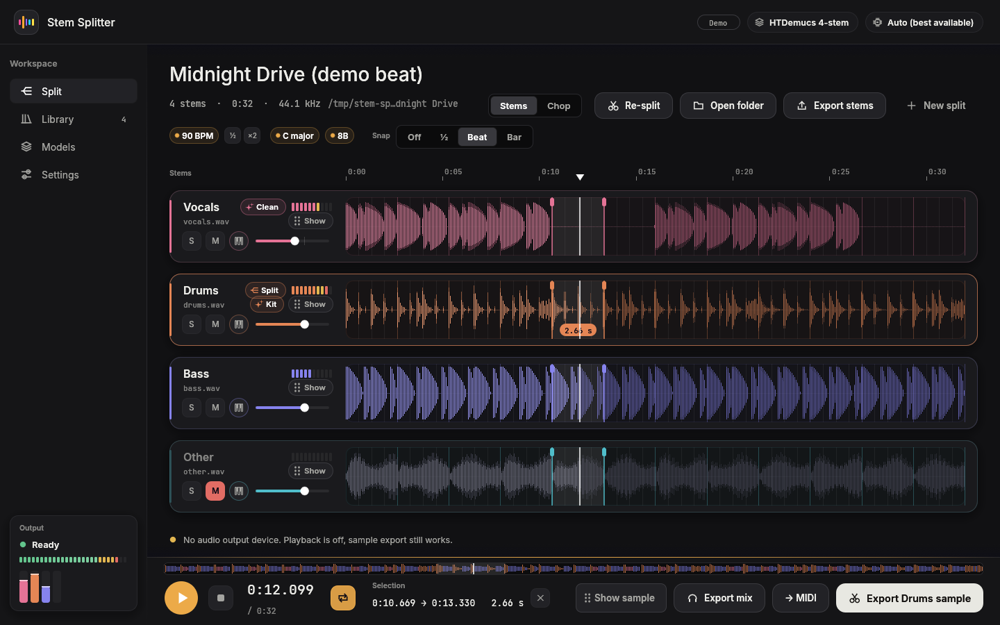
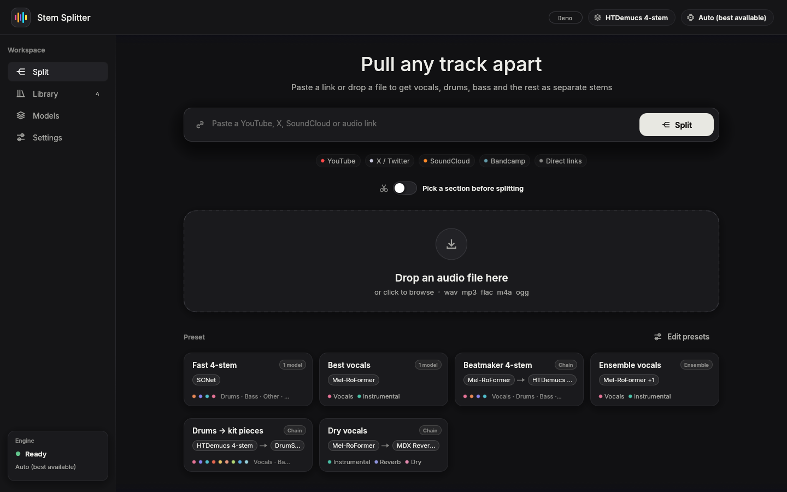
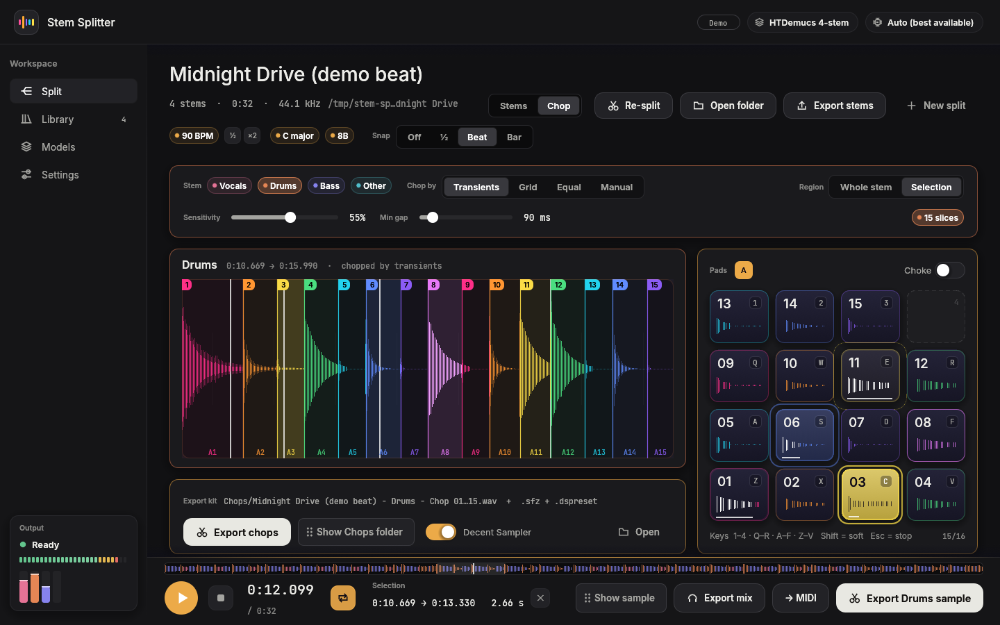
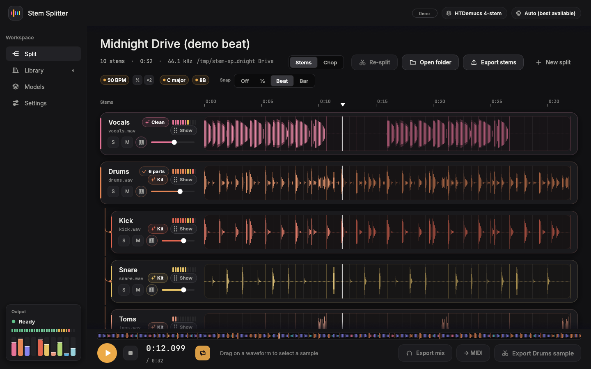
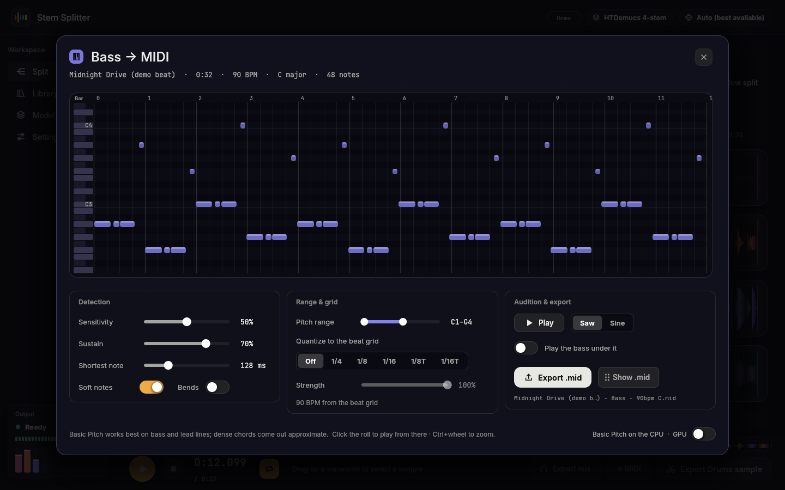
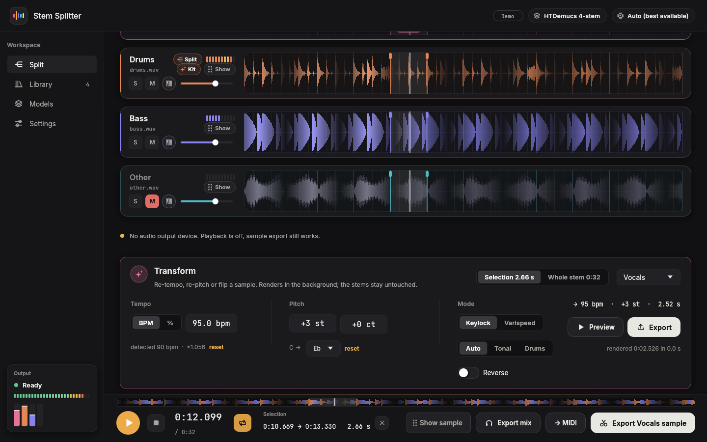
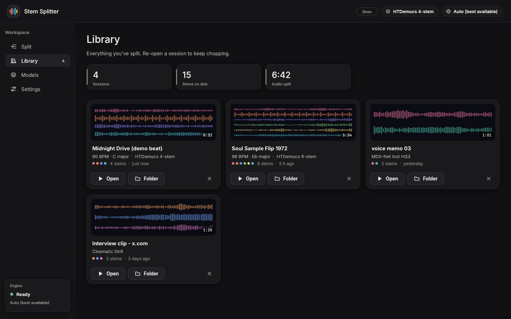

# Stem Splitter

Paste a YouTube, X/Twitter, SoundCloud or Bandcamp link, or drop an audio file, and get the vocals,
drums, bass and the rest back as separate stems. Then chop them onto pads, stretch them, turn them
into MIDI, or drag them straight into your DAW.

Stem Splitter is a Windows-first desktop app written in Rust (egui). The AI models run on ONNX
Runtime with DirectML, so they use the GPU on AMD, NVIDIA and Intel cards, and fall back to the CPU
when there is no GPU.

Made for sampling, beat-making and remixes. Only download material you have the right to use.



## Features

**Get the audio**
- Links from YouTube, X/Twitter, SoundCloud, Bandcamp and anything else yt-dlp supports, plus
  direct links. yt-dlp and ffmpeg are downloaded automatically.
- Playlists and several links at once go into a batch queue.
- Files can be dropped in: wav, mp3, flac, m4a, ogg.
- Optionally pick just a section of the track before splitting, snapped to bars.

**Split**
- Models include HTDemucs (4 and 6 stems), BS-RoFormer, Mel-RoFormer, SCNet and MDX-Net. See the
  [model table](#models).
- Presets and chains, for example vocals first, then a 4-stem split of the instrumental.
- Ensembles that average or combine several models (average, max-spec, min-spec).
- Drum stems can be split again into kick, snare, toms, hi-hat, ride and crash.
- Vocals can be cleaned up: de-reverb, de-echo and denoise.
- Results are cached, so running a model again on the same track is instant.

**Work with the stems**
- BPM and key detection, a beat grid with snapping, and zoom.
- Solo, mute and level per stem; select a region and export it as a sample.
- Drag stems or selections straight into FL Studio, Ableton or Explorer.
- Export to WAV (16/24-bit or float), FLAC or MP3. WAVs carry tempo and loop points (`acid` and
  `smpl` chunks), and file names come from your own template.
- **Chop mode:** slice by transients, grid or equal parts onto 16 MPC-style pads you can play from
  the keyboard. Export the slices plus an SFZ or Decent Sampler kit.
- **Time-stretch and pitch:** a phase vocoder for tonal stems and WSOLA for drums, so hits stay tight.
  Also varispeed and reverse.
- **Drum kit extractor:** pulls individual kick, snare and hat one-shots out of a drum stem.
- **Audio to MIDI:** Spotify's Basic Pitch with a piano roll and quantize. Export as `.mid`.

| | |
|---|---|
|  |  |
|  |  |
|  |  |

Press `?` in the app to see every keyboard shortcut.

## Models

Models download the first time you use them. Each one shows its license in the app.

| Model | Stems | License |
|---|---|---|
| HTDemucs | vocals, drums, bass, other | Code MIT; the author says the weights are for research only |
| HTDemucs 6s | + guitar, piano | Same as HTDemucs |
| BS-RoFormer | vocals, drums, bass, other | MIT |
| Mel-RoFormer (Kim) | vocals, instrumental | MIT |
| SCNet / SCNet Large | vocals, drums, bass, other | MIT |
| MDX-Net (Inst HQ 3/4, Kim Vocal 2, Voc FT, Karaoke 2) | vocals / instrumental, lead / backing vocals | MIT (UVR) |
| DrumSep MDX23C | kick, snare, toms, hi-hat, ride, crash | Personal use only |
| Reverb HQ, MDX23C De-Reverb, Mel-RoFormer De-Reverb-Echo | dry, reverb | Personal use only |
| Mel-RoFormer Denoise | clean, noise | Personal use only |

Models marked "personal use only" are labelled NC in the app and only download when you pick them.
Some of them aren't hosted as ONNX files. For those, run the export script in [`tools/`](tools)
once (it needs Python, PyTorch and onnx).

Speed on a 60-second clip, as multiples of realtime:

| Model | RX 6700S (DirectML) | Radeon iGPU | CPU (Ryzen 9 6900HS) |
|---|---|---|---|
| HTDemucs | 13.5x | 3.5x | 1.9x |
| DrumSep | 9.6x | | 0.7x |
| Reverb HQ | 14x | | 1.4x |

If a model runs out of GPU memory, or the GPU driver returns broken output, the app redoes the split
on the CPU.

## Install

Download `stem-splitter-windows` from the latest successful
[CI run](https://github.com/orth4x0r/stem-splitter/actions) on `main` and unzip it anywhere. It
contains `stem-splitter.exe` (the app) and `stem-cli.exe` (the command line). ONNX Runtime, yt-dlp,
ffmpeg and the models are downloaded into `%LOCALAPPDATA%\orth4x0r\Stem Splitter` when first needed.

Command line:

```
stem-cli list
stem-cli split <file-or-url> [--model htdemucs] [--device auto|cpu|N] [--out DIR]
```

## Build

```
cargo run --release -p stem-app
```

Linux works for development: you need ALSA headers (`libasound2-dev`), and the GPU path is
Windows-only. To cross-check the Windows target:
`cargo check --workspace --target x86_64-pc-windows-gnu`.

The workspace has four crates:

| Crate | What it does |
|---|---|
| `stem-audio` | Decoding, resampling, STFT, analysis, time-stretch, chopping, WAV/FLAC/MP3 output |
| `stem-fetch` | Turns a URL into an audio file, using yt-dlp and ffmpeg |
| `stem-models` | Model registry, downloads, and ONNX Runtime separators (MDX-Net, HTDemucs, RoFormer, SCNet, MDX23C, Basic Pitch) |
| `stem-app` | The egui app and `stem-cli` |

See [docs/PLAN.md](docs/PLAN.md) and [docs/DESIGN.md](docs/DESIGN.md).

## License

MIT. Model weights are downloaded at runtime and carry their own licenses (listed above and in the
app). Third-party code and algorithms are credited in [THIRD_PARTY.md](THIRD_PARTY.md).
